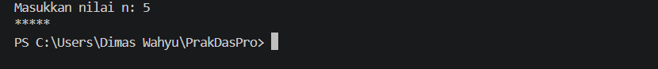
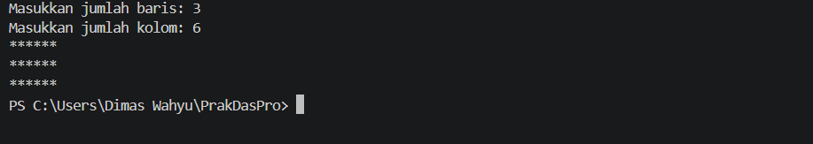
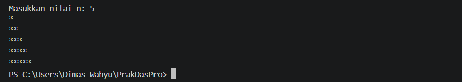
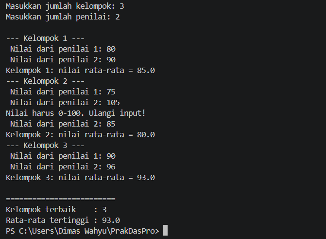
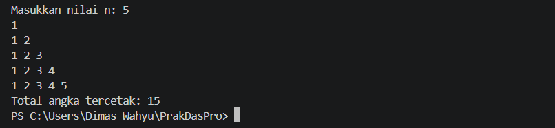

# JOBSHEET 8 - PERULANGAN 2

**Identitas Mahasiswa:**
* **Nama:** Dimas Wahyu Ramadhani
* **NIM:** 264107020104
* **Kelas / No. Presensi:** 1D / 12

___

## 1. TUJUAN PRAKTIKUM

Berikut adalah tujuan pelaksanaan praktikum pada bab ini:

1. Memahami konsep perulangan bersarang pada algoritma  
2. Memahami alur perulangan bersarang 
3. Mengenal sintaks perulangan bersarang 
4. Mampu menerapkan perulangan bersarang untuk menyelesaikan studi kasus sederhana.
- - -

## 2. HASIL PERCOBAAN & ANALISIS
### 2.1 Percobaan 1: Review Perulangan 1
Percobaan ini mengulang konsep perulangan `FOR` sebelum mempelajari perulangan bersarang. Program menampilkan karakter `*` sebanyak *n* kali secara mendatar (ke arah samping). Gunakan input *n* berupa bilangan bulat positif.
#### 2.1.1 Kode Program Java
```java
import java.util.Scanner;

public class Star12 {
    public static void main(String[] args) {
        Scanner sc = new Scanner(System.in);

        System.out.print("Masukkan nilai n: ");
        int n = sc.nextInt();

        for (int i = 1; i <= n; i++) {
            System.out.print("*");
        }
        System.out.println();
        sc.close();
    }
}
```
#### 2.1.2 Hasil Running / Screenshot Output
Berikut adalah contoh tampilan *output* setelah program dijalankan:


#### 2.1.3 Jawaban Pertanyaan / Pertanyaan Refleksi
* **Pertanyaan 1:** Jika inisialisasi `i = 1` diubah menjadi `i = 0` tanpa mengubah kondisi, berapa karakter `*` yang tercetak ketika n = 5? Jelaskan.
    * **Jawab:** Karakter `*` akan tercetak sebanyak 6 karena angka 0 bernilai true sehingga `i` bernilai 0, 1, 2, 3, 4, 5.
* **Pertanyaan 2:** Jika kondisi `i <= n` diganti menjadi `i < n`, berapa kali perulangan dijalankan saat n = 5? Mengapa hasilnya berbeda?
    * **Jawab:** Karakter `*` akan tercetak sebanyak 4 karena ketika `i` bernilai 5 hasilnya false.
* **Pertanyaan 3:** Prediksi output potongan kode berikut ketika n = 9, kemudian buktikan dengan mengganti perulangan FOR pada program Anda dan menjalankannya.
    ```java
    for (int i = 2; i <= n; i += 2) {
        System.out.print(i + " ");
    }
    ```
    Modifikasi kode tersebut agar mencetak bilangan **ganjil** positif yang tidak melebihi n.
    * **Jawab:** Dengan mengubah inisialisasi `i` menjadi 1.
        ```java
        for (int i = 1; i <= n; i +=2 ) {
                System.out.print(i + " ");
            }
        ```
* **Pertanyaan 4:** Jelaskan mengapa perubahan *increment* `i++` menjadi `i--` (dengan kondisi tetap `i <= n`) membuat perulangan berjalan terus-menerus dan tidak berhenti dalam waktu wajar untuk n positif. Jangan menjalankan versi tersebut; jika terlanjur berjalan, hentikan program dengan menekan **Ctrl + C** pada terminal. 
    * **Jawab:** Karena mengakibatkan kondisi selalu bernilai true sehingga loop tidak pernah berhenti (infinite loop).
---

### 2.2 Percobaan 2: Pola Bintang Persegi Panjang (Nested FOR)
Pada percobaan ini digunakan nested loop FOR untuk mencetak persegi panjang bintang. Jumlah baris dan kolom dimasukkan secara terpisah sehingga peran kedua loop dapat diamati dengan jelas: outer loop mengatur baris, sedangkan inner loop mengatur kolom (ingat analogi rak/loker pada materi).
#### 2.2.1 Kode Program Java
```java
import java.util.Scanner;

public class Rectangle12 {
    public static void main(String[] args) {
        Scanner sc = new Scanner(System.in);

        System.out.print("Masukkan jumlah baris: ");
        int baris = sc.nextInt();
        System.out.print("Masukkan jumlah kolom: ");
        int kolom = sc.nextInt();

        for (int i = 1; i <= baris; i++) {
            for (int j = 1; j <= kolom; j++) {
                System.out.print("*");  
            }
            System.out.println();
        }
        sc.close();
    }
}
```
#### 2.2.2 Hasil Running / Screenshot Output
Berikut adalah contoh tampilan *output* setelah program dijalankan:


#### 2.2.3 Jawaban Pertanyaan / Pertanyaan Refleksi
* **Pertanyaan 1:** Tentukan fungsi variabel `i` dan `j` pada program tersebut.
    * **Jawab:** Variabel `i` digunakan untuk menghitung banyak baris pada outer loop sedangkan `j` digunakan untuk menghitung banyak kolom pada inner lopo.
* **Pertanyaan 2:** Berapa kali outer loop, inner loop, dan perintah `print("*")` dijalankan untuk baris = 4 dan kolom = 7? 
    * **Jawab:**
        * Outer loop: 4 kali.
        * Inner loop: 7 kali.
        * `print("*"):`: 28 kali.
* **Pertanyaan 3:** Apa yang terjadi jika batas perulangan luar dan dalam ditukar (outer menggunakan `kolom`, inner menggunakan `baris`)? Gunakan baris = 3 dan kolom = 6 untuk menjelaskan.
    * **Jawab:** Apabila dibalik (outer menggunakan `kolom` dan inner menggunakan `baris`) maka hasilnya 6 baris dan 3 kolom. Awalnya 3 x 6 tetapi setelah dibalik menjadi 6 x 3.
* **Pertanyaan 4:** Jelaskan akibat penghapusan `System.out.println();` setelah inner loop.
    * **Jawab:** Karakter `*` akan berpindah menjadi satu baris panjang, tidak berpindah baris.
* **Pertanyaan 5:** Modifikasi program agar karakter yang dicetak adalah `#`, lalu commit dan push perubahan ke GitHub.
    * **Jawab:**
        ```java
        import java.util.Scanner;

        public class Rectangle12 {
            public static void main(String[] args) {
                Scanner sc = new Scanner(System.in);

                System.out.print("Masukkan jumlah baris: ");
                int baris = sc.nextInt();
                System.out.print("Masukkan jumlah kolom: ");
                int kolom = sc.nextInt();

                for (int i = 1; i <= baris; i++) {
                    for (int j = 1; j <= kolom; j++) {
                        System.out.print("#");  
                    }
                    System.out.println();
                }
                sc.close();
            }
        }
        ```
---

### 2.3 Percobaan 3: Debugging Bintang Segitiga - Nested WHILE
Kode awal pada percobaan ini sengaja dibuat belum menghasilkan format segitiga yang benar. Tugas Anda adalah mengidentifikasi kesalahannya dan memperbaikinya tanpa mengganti struktur WHILE menjadi FOR.  
#### 2.3.1 Kode Program Java
```java
import java.util.Scanner;

public class Triangle12 {
    public static void main(String[] args) {
        Scanner sc = new Scanner(System.in);

        System.out.print("Masukkan nilai n: ");
        int n = sc.nextInt();

        int i = 1;
        while (i <= n) {
            int j = 0;
            while (j < i) {
                System.out.print("*");   
                j++;
            }
            System.out.println();
            i++;
        }
        sc.close();
    }
}
```
#### 2.3.2 Hasil Running / Screenshoot Output
Berikut adalah contoh tampilan *output* setelah program dijalankan:


#### 2.3.3 Jawaban Pertanyaan / Pertanyaan Refleksif
* **Pertanyaan 1:** Sebutkan ketidaksesuaian output awal dan minimal dua perbaikan yang diperlukan untuk menghasilkan pola segitiga bertingkat.
    * **Jawab:** Inisialisasi integer dan penggunaan `System.out.println();`. Mengubah variabel `i` menjadi 1 dan meletakkan `System.out.println();` setelah inner loop.
* **Pertanyaan 2:** Jelaskan peran variabel `i` dan `j`. Mengapa nilai `j` harus diinisialisasi kembali ke 0 pada setiap iterasi outer loop? Apa yang terjadi jika `j` tidak di-reset? 
    * **Jawab:** Variabel `i` digunakan untuk menghitung banyaknya baris dan `j` untuk menghitung banyaknya bintang dalam satu baris. Variabel `j` perlu diinisialisasi menjadi 0 karena inner loop butuh mulai dari awal untuk setiap baris. Jika variabel `j` tidak direset, maka nilai j akan terus bertambah dari baris sebelumnya dan tidak kembali ke 0.
* **Pertanyaan 3:** Jelaskan perubahan inisialisasi, kondisi, dan perubahan nilai (update) pada outer loop yang diperlukan untuk membentuk segitiga terbalik. 
    * **Jawab:**
        * Inisialisasi: mengubah nilai `int` menjadi 1.
        * Kondisi: tetap `i <= n`.
        * Update: tetap `i++`.
        Untuk membentuk segitiga terbalik hal yang perlu diubah yaitu kondisi pada inner loop yang sebelumnya `j < i` menjadi `j < n-i+1`.
---

### 2.4 Percobaan 4: Studi Kasus Nilai Tugas Proyek Kelompok
Dalam penilaian proyek kelompok, setiap kelompok memperoleh nilai dari sejumlah penilai. Program menerima jumlah kelompok dan jumlah penilai yang sama untuk setiap kelompok, kemudian menghitung rata-rata nilai tiap kelompok dan menentukan kelompok dengan ratarata tertinggi. Kasus ini diselesaikan dengan nested loop tanpa perlu menyimpan seluruh nilai: WHILE (luar) untuk kelompok, FOR (tengah) untuk penilai, dan DO-WHILE (dalam) untuk mengulang input nilai yang tidak valid. 
#### 2.4.1 Kode Progran Java
```java
import java.util.Scanner;

public class NilaiKelompok12 {
    public static void main(String[] args) {
        Scanner sc = new Scanner(System.in);
        System.out.print("Masukkan jumlah kelompok: ");
        int jumlahKelompok = sc.nextInt();
        System.out.print("Masukkan jumlah penilai: ");
        int jumlahPenilai = sc.nextInt();

        if (jumlahKelompok <= 0 || jumlahPenilai <= 0) {
            System.out.println("Jumlah kelompok dan penilai harus > 0.");
        } else {
            int nomorKelompok = 1;
            double rataTertinggi = -1;
            int kelompokTerbaik = 0;
            System.out.println();

            while (nomorKelompok <= jumlahKelompok) {
                System.out.println("--- Kelompok " + nomorKelompok + " ---");
                double totalNilai = 0;
                for (int j = 1; j <= jumlahPenilai; j++) {
                    int nilai;
                    do {
                        System.out.print(" Nilai dari penilai " + j + ": ");
                        nilai = sc.nextInt();
                        if (nilai < 0 || nilai > 100) {
                            System.out.println("Nilai harus 0-100. Ulangi input!");
                        }
                    } while (nilai < 0 || nilai > 100);
                    totalNilai += nilai;
                }
                double rataNilai = totalNilai / jumlahPenilai;
                System.out.println("Kelompok " + nomorKelompok + ": nilai rata-rata = " + rataNilai);
                if (rataNilai > rataTertinggi) {
                    rataTertinggi = rataNilai;
                    kelompokTerbaik = nomorKelompok;
                }
                nomorKelompok++;
            }
            System.out.println("\n=========================");
            System.out.println("Kelompok terbaik    : " + kelompokTerbaik);
            System.out.println("Rata-rata tertinggi : " + rataTertinggi);
        }
        sc.close();
    }
}
```
#### 2.4.2 Hasil Running / Screenshoot Output
Berikut adalah contoh tampilan *output* setelah program dijalankan:


#### 2.4.3 Jawaban Pertanyaan / Pertanyaan Refleksif
* **Pertanyaan 1:** Mengapa `totalNilai` perlu di-reset di dalam outer loop, tetapi `rataTertinggi` tidak boleh di-reset pada setiap kelompok?
    * **Jawab:** 
        * `totalNilai`: perlu di-reset supaya nilai kelompok pertama tidak bertambah ke nilai kelompok berikutnya.
        * `rataTertinggi`: tidak perlu di-riset karena digunakan untuk menyimpan rata-rata tertinggi dari seluruh kelompok.
* **Pertanyaan 2:** Untuk 3 kelompok dan 2 penilai (tanpa input yang salah), berapa kali badan perulangan FOR dijalankan secara keseluruhan?
    * **Jawab:** Melakukan perulagan `FOR` sebanyak 6 kali. Menginput 2 nilai dari masing-masing kelompok (3 kelompok).
* **Pertanyaan 3:** Apa yang terjadi jika totalNilai dideklarasikan sebagai int dan rata-rata dihitung menggunakan pembagian dua bilangan bulat? Berikan contoh nilai.
    * **Jawab:** Jika totalNilai dan jumlahPenilai menggunakan tipe data yang sama yaitu int, maka java akan melakukan pembagian  bilangan bulat terlebih dahulu sehingga bagian desimal hasil pembagian dibuang. Kemudian hasilnya akan disimpan ke variabel rataNilai.
    ```java
    // Kedua variabel menggunakan tipe data int
        int totNilai = 50;
        int jumPenilai = 4;

        double rerataNilai = totNilai / jumPenilai;
        System.out.print(rerataNilai);
    // Output: 12.0
    ```
    ```java
    // Variabel totNilai menggunakan tipe data double
        double totNilai = 50;
        int jumPenilai = 4;

        double rerataNilai = totNilai / jumPenilai;
        System.out.print(rerataNilai);
    // Output: 12.5
    ```
* **Pertanyaan 4:** Mengapa rataTertinggi diberi nilai awal -1, bukan 0? Berikan contoh input yang membuat hasil salah apabila nilai awalnya 0.
    * **Jawab:** Karena jika semua kelompok mendapatkan rata-rata 0, maka kelompok pertama yang akan mendapat gelar kelompok terbaik. Contohnya ketika kelompok 1 dan kelompok 2 mendapaat rata-rata 0, maka `rataNilai > rataTertinggi` bernilai false sehingga variabel `kelompokTerbaik` bernilai 0.
* **Pertanyaan 5:** Program ini memiliki tiga tingkat perulangan. Sebutkan masing-masing jenis perulangan beserta perannya.
    * **Jawab:**
        * `while` (outer loop): digunakan untuk mengulang kelompok satu persatu hingga jumlah kelompok terpenuhi.
        * `for` (mid loop): digunakan untuk mengulang proses input nilai dari setiap penilai dalam satu kelompok sesuai jumlah penilai.
        * `do-while` (inner loop): digunakan untuk melakukan proses input nilai dari setiap penilai dan memastikan nilai yang diinput berada dalam rentang 0-100.
---

## 3. TUGAS
### 3.1 Tugas 1: Pola Bilangan Bertingkat
#### 3.1.1 Kode Program Java
```java
import java.util.Scanner;

public class Tugas1_12 {
    public static void main(String[] args) {
        Scanner sc = new Scanner(System.in);

        System.out.print("Masukkan nilai n: ");
        int n = sc.nextInt();

        int i = 1;
        int tot = 0;
        while (i <= n) {
            int j = 1;
            while (j <= i) {
                System.out.print(j + " ");
                tot++;
                j++;
            }
            System.out.println();
            i++;
        }
        System.out.println("Total angka tercetak: " + tot);
        sc.close();
    }
}
```
#### 3.1.2 Hasil Running / Screenshoot Output
Berikut adalah contoh tampilan *output* setelah program dijalankan:


---
### 3.2 Tugas 2: Tabel Perkalian
#### 3.2.1 Kode Program Java
```java

```
#### 3.1.2 Hasil Running / Screenshoot Output
Berikut adalah contoh tampilan *output* setelah program dijalankan:


---
### 3.3 Tugas 3: 
#### 3.3.1 Kode Program Java
```java

```
#### 3.3.2 Hasil Running / Screenshoot Output
Berikut adalah contoh tampilan *output* setelah program dijalankan:


---

## 4. KESIMPULAN
