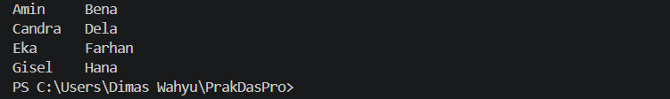

# JOBSHEET 11 - ARRAY 2 DIMENSI

**Identitas Mahasiswa:**
* **Nama:** Dimas Wahyu Ramadhani
* **NIM:** 264107020104
* **Kelas / No. Presensi:** 1D / 12

___

## 1. TUJUAN PRAKTIKUM

Berikut adalah tujuan pelaksanaan praktikum pada bab ini:

1. Mendeklarasikan, menginstansiasi, dan menginisialisasi array 2 dimensi dalam bahasa Java. 
2. Mengakses dan mengisi elemen array 2 dimensi menggunakan indeks baris dan kolom. 
3. Memproses array 2 dimensi dengan nested loop, baik for maupun foreach. 
4. Membuat array 2 dimensi dengan panjang baris yang berbeda (*jagged array*). 
5. Menghitung nilai rata-rata per baris dan per kolom pada studi kasus nyata. 
- - -

## 2. HASIL PERCOBAAN & ANALISIS
### 2.1 Percobaan 1: Deklarasi, Inisialisasi, Mengisi, dan Menampilkan Array 2 Dimensi
#### 2.1.1 Kode Program Java
```java
public class Bioskop12Array {
    public static void main(String[] args) {
        
        String [][] penonton = new String[4][2];
        penonton [0][0] = "Amin";
        penonton [0][1] = "Bena";
        penonton [1][0] = "Candra";
        penonton [1][1] = "Dela";
        penonton [2][0] = "Eka";
        penonton [2][1] = "Farhan";
        penonton [3][0] = "Gisel";
        penonton [3][1] = "Hana";

        System.out.printf("%s \t %s\n", penonton [0][0], penonton [0][1]);
        System.out.printf("%s \t %s\n", penonton [1][0], penonton [1][1]);
        System.out.printf("%s \t %s\n", penonton [2][0], penonton [2][1]);
        System.out.printf("%s \t %s\n", penonton [3][0], penonton [3][1]);
    }
}
```
#### 2.1.2 Hasil Running / Screenshot Output
Berikut adalah contoh tampilan *output* setelah program dijalankan:



#### 2.1.3 Jawaban Pertanyaan / Pertanyaan Refleksi
* **Pertanyaan 1:** Apakah pengisian elemen array harus dilakukan secara berurutan mulai dari indeks ke-0? Jelaskan!
    * **Jawab:** Tidak harus. Pengisian elemen array dapat diisi secara acak selama indeks yang digunakan masih berada di dalam rentang ukuran array, tetapi indeks harus sesuai dengan posisi baris dan kolom yang diinginkan.
* **Pertanyaan 2:** Mengapa terdapat *null* pada daftar nama penonton? Jelaskan dari sisi nilai default array.
    * **Jawab:** Karena elemen array bertipe data String yang belum diisi sehingga memiliki nilai default `null`. Pada kode tersebut, seluruh elemen array sudah berisi nilai sehingga `null` tidak muncul. 
* **Pertanyaan 3:** Lengkapi pengisian pada langkah 3 jika ada elemen yang belum terisi, lalu jalankan kembali program.
    * **Jawab:** Seluruh elemen array sudah terisi sehingga tidak ada `null`, sehingga hasilnya:
    
        ```
        Amin     Bena
        Candra   Dela
        Eka      Farhan
        Gisel    Hana
        ```

* **Pertanyaan 4:** Tambahkan kode berikut setelah langkah 4. Jelaskan fungsi dari `penonton.length` dan `penonton[0].length`!
    ```java
    System.out.println(penonton.length);
    System.out.println(penonton[0].length);
    System.out.println(penonton[1].length);
    System.out.println(penonton[2].length);
    System.out.println(penonton[3].length);
    ```
    * **Jawab:**
        * `penonton.length` berfungsi untuk menampilkan ukuran baris penonton. Output: `4`
        * `penonton[0].length` berfungsi untuk menampilkan ukuran kolom penonton pada baris indeks ke-i. Output: `2, 2, 2, 2`.
* **Pertanyaan 5:** Apakah `penonton[0].length, penonton[1].length, penonton[2].length, penonton[3].length` memiliki nilai yang sama? Mengapa?
    * **Jawab:** Nilai sama karena telah diinstansiasi dengan panjang kolom 2.
* **Pertanyaan 6:** Modifikasi kode pada pertanyaan 4 untuk menampilkan panjang setiap baris menggunakan `for` loop. Compile, run, lalu amati hasilnya.
    ```java
    System.out.println(penonton.length);

    for (int i = 0; i < penonton.length; i++) {
        System.out.println("Panjang baris ke-" + (i + 1) + ": " + penonton[i].length);
    }
    ```
    * **Jawab:** Akan menambahkan output berikut:

        ```
        4
        Panjang baris ke-1: 2
        Panjang baris ke-2: 2
        Panjang baris ke-3: 2
        Panjang baris ke-4: 2
        ```
* **Pertanyaan 7:** Modifikasi kode pada pertanyaan 5 untuk menampilkan panjang setiap baris menggunakan foreach loop. Compile, run, lalu amati hasilnya.
    ```java
    System.out.println(penonton.length);

    for (String[] barisPenonton : penonton) {
        System.out.println("Panjang baris: " + barisPenonton.length); 
    }
    ```
    * **Jawab:** Akan menambahkan output berikut:

        ```
        Panjang baris: 2
        Panjang baris: 2
        Panjang baris: 2
        Panjang baris: 2
        ```
* **Pertanyaan 8:** Tambahkan kode untuk menampilkan nama penonton pada baris ke-3 (indeks 2) menggunakan `for` loop. Compile, run, lalu amati hasilnya.
    ```java
    System.out.println("Penonton pada baris ke-3: "); 

    for (int i = 0; i < penonton[2].length; i++) { 
        System.out.println(penonton[2][i]); 
    } 
    ```
    * **Jawab:** Akan menambahkan output berikut:
        
        ```
        Penonton pada baris ke-3:
        Eka 
        Farhan
        ```
* **Pertanyaan 9:** Modifikasi kode pada pertanyaan 8 menjadi perulangan dengan `foreach` loop. Compile, run, lalu amati hasilnya.
    ```java
    System.out.println("Penonton pada baris ke-3: ");

    for (String i : penonton[2]) { 
        System.out.println(i); 
    } 
    ```
    * **Jawab:** Akan menambahkan output berikut:

        ```
        Penonton pada baris ke-3:
        Eka 
        Farhan
        ```
* **Pertanyaan 10:** Modifikasi kode pada pertanyaan 9 untuk menampilkan nama penonton setiap baris. Gunakan `String.join()`, compile, run, lalu amati hasilnya.
    ```java
    for (int i = 0; i < penonton.length; i++) { 
    System.out.println("Penonton pada baris ke-" + (i + 1) + ": " + 
        String.join(", ", penonton[i])); 
    } 
    ```
    * **Jawab:** Akan menambahkan output berikut:

        ```
        Penonoton pada baris ke-1: Amin, Bena
        Penonoton pada baris ke-2: Candra, Dela
        Penonoton pada baris ke-3: Eka, Farhan
        Penonoton pada baris ke-4: Gisel, Hana
* **Pertanyaan 11:** Menurut Anda, apa kekurangan dan kelebihan `foreach` loop dibandingkan `for` loop?
    * **Jawab:**
        * Kelebihan `foreach`: sintaks lebih singkat, tidak perlu mengatur indeks dan batas loop, mengurangi kemungkinan kesalahan `ArrayIndexOutOfBoundsException`.
        * Kekurangan `foreach`: tidak adanya indeks, tidak dapat menjalankan isi elemen array dari depan atau belakang, tidak cocok untuk mengisi atau mengubah isi array.
        * `for` biasanya lebih fleksibel dan dipakai ketika indeks dibutuhkan, sedangkan `foreach` cocok untuk membaca seluruh isi elemen array dengan urut dari depan.
* **Pertanyaan 12:** Berapa indeks baris maksimmal untuk array `penonton`? Dari mana nilai itu diperoleh?
    * **Jawab:** Indeks baris maksimal 3. Nilai ini diperoleh dari `penonton.length - 1` yaitu 4-1 karena indeks dimulai dari 0.
* **Pertanyaan 13:** Berapa indeks kolom maksimal untuk array `penonton`? Apakah nilainya sama untuk setiap baris?
    * **Jawab:** Indeks kolom maksimal 1. Nilai ini diperoleh dari `penonton[i].length - 1` yaitu 2-1. Nilai setiap baris sudah dibuat dengan 2 kolom.
* **Pertanyaan 14:** Apa fungsi `String.join()`? Jelaskan parameter yang diterimanya.
    * **Jawab:** 
---

### 2.2 Percobaan 2: Scanner dan Perulangan untuk Input dan Output Array 2 Dimensi
#### 2.2.1 Kode Program Java
```java
import java.util.Scanner;

public class BioskopWithScanner12 {
    public static void main(String[] args) {
        Scanner sc = new Scanner(System.in);

        int baris, kolom;
        String nama, pilihan;
        String [][] penonton = new String[4][2];

        while (true) {
            System.out.print("Masukkan nama: ");
            nama = sc.nextLine();
            System.out.print("Masukkan baris: ");
            baris = sc.nextInt();
            System.out.print("Masukkan kolom: ");
            kolom = sc.nextInt();
            sc.nextLine();

            penonton [baris - 1][kolom - 1] = nama;

            System.out.print("Input penonton lainnya? (y/n): ");
            pilihan = sc.nextLine();

            if (pilihan.equalsIgnoreCase("n")) {
                break;
            }
        }
        sc.close();
    }
}
```
#### 2.2.2 Hasil Running / Screenshot Output
Berikut adalah contoh tampilan *output* setelah program dijalankan:


#### 2.2.3 Jawaban Pertanyaan / Pertanyaan Refleksi
* **Pertanyaan 1:** Apakah pengisian elemen array dari Scanner harus dilakukan secara berurutan mulai dari indeks ke-0? Jelaskan!
    * **Jawab:** Tidak harus. Pengisian elemen array dapat diisi secara acak selama indeks yang digunakan masih berada di dalam rentang ukuran array, tetapi indeks harus sesuai dengan posisi baris dan kolom yang diinginkan.
* **Pertanyaan 2:** Modifikasi program agar menampilkan menu berikut:
    | Menu | Fungsi |
    | --- | --- |
    | 1 | Input data penonton |
    | 2 | Tampilkan daftar penonton |
    | 3 | Exit |
    * **Jawab:**
* **Pertanyaan 3:** Modifikasi program untuk menangani nomor baris atau kolom yang tidak tersedia (misalnya baris 7 atau kolom 0).
    * **Jawab:** 
* **Pertanyaan 4:** Pada menu 1, tampilkan peringatan jika kursi yang dipilih sudah terisi penonton lain, lalu minta baris dan kolom kembali.
    * **Jawab:**
* **Pertanyaan 5:** Pada menu 2, jika sebuah kursi kosong (`null`), tampilkan `***` sebagai pengganti `null`.
    * **Jawab:**
---

### 2.3 Percobaan 3: Array 2 Dimensi dengan Panjang Baris Berbeda
#### 2.3.1 Kode Program Java
```java
import java.util.Arrays;

public class Numbers12 {
    public static void main(String[] args) {
        
        int [][] myNumbers = new int[3][];
        myNumbers[0] = new int[5];
        myNumbers[1] = new int[3];
        myNumbers[2] = new int[1];

        for (int i = 0; i < myNumbers.length; i++) {
            System.out.println(Arrays.toString(myNumbers[i]));
        }
    }
}
```
#### 2.3.2 Hasil Running / Screenshot Output
Berikut adalah contoh tampilan *output* setelah program dijalankan:


#### 2.3.3 Jawaban Pertanyaan / Pertanyaan Refleksi
* **Pertanyaan 1:** Apa fungsi dari `Arrays.toString()`?
    * **Jawab:**
* **Pertanyaan 2:** Pada kode 16, `Arrays.toString()` dipanggil pada `myNumbers[i]`. Ganti pemanggilnya menjadi `Arrays.toString(myNumbers)`, lalu compile dan jalankan. Apa yang tampil? Jelaskan!
    * **Jawab:**
* **Pertanyaann 3:** Jelaskan juga `System.out.println(Arrays.deepToString(myNumbers));`. Bandingkan hasilnya dengan Kode 16. Mengapa `deepToString()` diperlukan untuk array 2 dimensi?
    * **Jawab:**
* **Pertanyaan 4:** Apa nilai default untuk elemen array dengan tipe data `int`?
    * **Jawab:**
* **Pertanyaan 5:** Tambahkan kode berikut untuk menampilkan panjang setiap baris. Compile dan run, lalu amati hasilnya. 
    ```java
    for (int i = 0; i < myNumbers.length; i++) { 
        System.out.println("Panjang baris ke-" + (i + 1) + ": " + 
    myNumbers[i].length); 
    } 
    * **Jawab:** 
* **Pertanyaan 6:** Array `myNumbers` memiliki panjang yang berbeda untuk setiap barisnya. Apakah panjang array dapat dimodifikasi setelah diinstansiasi? Jelaskan. 
    * **Jawab:**
* **Pertanyaan 7:** Jalankan `myNumbers[0] = new int[7];` setelah instansiasi, lalu cetak `myNumbers.length` dan `myNumbers[0].length`. Bagian mana yang berubah? Mengapa?
    * **Jawab:**
---

### 2.4 Percobaan 4:  Studi Kasus SIAKAD
#### 2.4.1 Kode Program Java
```java
import java.util.Scanner;

public class SIAKAD12 {
    public static void main(String[] args) {
        Scanner sc = new Scanner(System.in);

        int [][] nilai = new int[4][3];

        for (int i = 0; i < nilai.length; i++) {
            System.out.println("Input nilai mahasiswa ke-" + (i + 1));
            double totalPerSiswa = 0; 

            for (int j = 0; j < nilai[i].length; j++) {
                System.out.println("Nilai mata kuliah " + (j + 1) + ": ");
                nilai[i][j] = sc.nextInt();
                totalPerSiswa += nilai[i][j];
            }
            System.out.println("Nilai rata-raata: " + totalPerSiswa / nilai[i].length);
        }

        System.out.println("\n====================================");
        System.out.println("Rata-rata nilai setiap mata kuliah: ");

        for (int  j= 0; j < nilai[0].length; j++) {
            double totalPerMatkul = 0;

            for (int i = 0; i < nilai.length; i++) {
                totalPerMatkul += nilai[i][j];
            }
            System.out.println("Mata kuliah " + (j + 1) + ": " + totalPerMatkul / nilai.length);
        }
        sc.close();
    }
}
```
#### 2.4.2 Hasil Running / Screenshot Output
Berikut adalah contoh tampilan *output* setelah program dijalankan:


#### 2.4.3 Jawaban Pertanyaan / Pertanyaan Refleksi
* **Pertanyaan 1:** Bagaimana jika jumlah mahasiswa dan jumlah mata kuliah berubah? Modifikasi program SIAKAD agar jumlah mahasiswa dan mata kuliah dapat ditentukan saat program berjalan.
    * **Jawab:**
---

## 3. TUGAS
### 3.1 Tugas 1: Implementasi Flowchart
Implementasikan flowchart latihan survei pada slide Dasar Pemrograman (Teori) ke dalam program Java. Data survei terdiri dari 10 responden dan 6 pertanyaan dengan jawaban 1 sampai 5. Program harus: 
* menyimpan hasil survei ke dalam array 2 dimensi; 
* menampilkan nilai rata-rata untuk setiap responden; 
* menampilkan nilai rata-rata untuk setiap pertanyaan; 
* menampilkan nilai rata-rata secara keseluruhan. 
#### 3.1.1 Kode Program Java
```java

```
#### 3.1.2 Hasil Running / Screenshot Output
Berikut adalah contoh tampilan *output* 