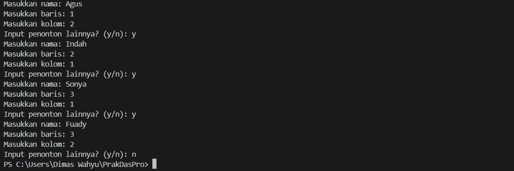
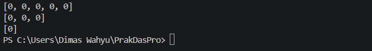
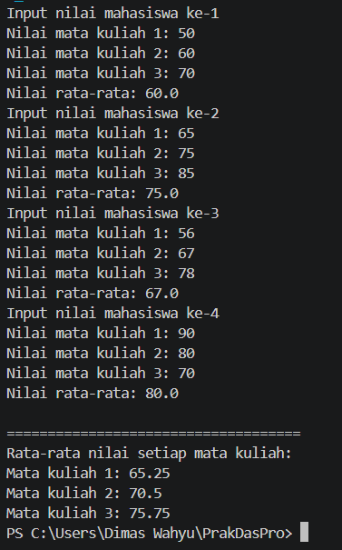
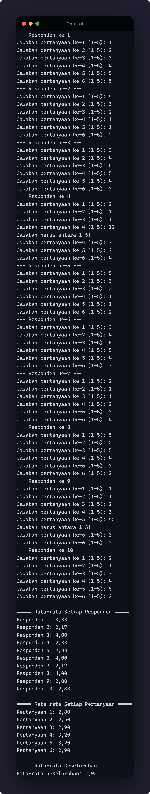

# JOBSHEET 11 - ARRAY 2 DIMENSI

**Identitas Mahasiswa:**
* **Nama:** Dimas Wahyu Ramadhani
* **NIM:** 264107020104
* **Kelas / No. Presensi:** 1D / 12

___

## 1. TUJUAN PRAKTIKUM

Berikut adalah tujuan pelaksanaan praktikum pada bab ini:

1. Mendeklarasikan, menginstansiasi, dan menginisialisasi array 2 dimensi dalam bahasa Java. 
2. Mengakses dan mengisi elemen array 2 dimensi menggunakan indeks baris dan kolom. 
3. Memproses array 2 dimensi dengan nested loop, baik for maupun foreach. 
4. Membuat array 2 dimensi dengan panjang baris yang berbeda (*jagged array*). 
5. Menghitung nilai rata-rata per baris dan per kolom pada studi kasus nyata. 
- - -

## 2. HASIL PERCOBAAN & ANALISIS
### 2.1 Percobaan 1: Deklarasi, Inisialisasi, Mengisi, dan Menampilkan Array 2 Dimensi
#### 2.1.1 Kode Program Java
```java
public class Bioskop12Array {
    public static void main(String[] args) {
        
        String [][] penonton = new String[4][2];
        penonton [0][0] = "Amin";
        penonton [0][1] = "Bena";
        penonton [1][0] = "Candra";
        penonton [1][1] = "Dela";
        penonton [2][0] = "Eka";
        penonton [2][1] = "Farhan";
        penonton [3][0] = "Gisel";
        penonton [3][1] = "Hana";

        System.out.printf("%s \t %s\n", penonton [0][0], penonton [0][1]);
        System.out.printf("%s \t %s\n", penonton [1][0], penonton [1][1]);
        System.out.printf("%s \t %s\n", penonton [2][0], penonton [2][1]);
        System.out.printf("%s \t %s\n", penonton [3][0], penonton [3][1]);
    }
}
```
#### 2.1.2 Hasil Running / Screenshot Output
Berikut adalah contoh tampilan *output* setelah program dijalankan:


#### 2.1.3 Jawaban Pertanyaan / Pertanyaan Refleksi
* **Pertanyaan 1:** Apakah pengisian elemen array harus dilakukan secara berurutan mulai dari indeks ke-0? Jelaskan!
    * **Jawab:** Tidak harus. Pengisian elemen array dapat diisi secara acak selama indeks yang digunakan masih berada di dalam rentang ukuran array, tetapi indeks harus sesuai dengan posisi baris dan kolom yang diinginkan.
* **Pertanyaan 2:** Mengapa terdapat *null* pada daftar nama penonton? Jelaskan dari sisi nilai default array.
    * **Jawab:** Karena elemen array bertipe data String yang belum diisi sehingga memiliki nilai default `null`. Pada kode tersebut, seluruh elemen array sudah berisi nilai sehingga `null` tidak muncul. 
* **Pertanyaan 3:** Lengkapi pengisian pada langkah 3 jika ada elemen yang belum terisi, lalu jalankan kembali program.
    * **Jawab:** Seluruh elemen array sudah terisi sehingga tidak ada `null`, sehingga hasilnya:
    
        ```
        Amin     Bena
        Candra   Dela
        Eka      Farhan
        Gisel    Hana
        ```

* **Pertanyaan 4:** Tambahkan kode berikut setelah langkah 4. Jelaskan fungsi dari `penonton.length` dan `penonton[0].length`!
    ```java
    System.out.println(penonton.length);
    System.out.println(penonton[0].length);
    System.out.println(penonton[1].length);
    System.out.println(penonton[2].length);
    System.out.println(penonton[3].length);
    ```
    * **Jawab:**
        * `penonton.length` berfungsi untuk menampilkan ukuran baris penonton. Output: `4`
        * `penonton[0].length` berfungsi untuk menampilkan ukuran kolom penonton pada baris pertama. Output: `2, 2, 2, 2`.
* **Pertanyaan 5:** Apakah `penonton[0].length, penonton[1].length, penonton[2].length, penonton[3].length` memiliki nilai yang sama? Mengapa?
    * **Jawab:** Nilai sama karena telah diinstansiasi dengan panjang kolom 2.
* **Pertanyaan 6:** Modifikasi kode pada pertanyaan 4 untuk menampilkan panjang setiap baris menggunakan `for` loop. Compile, run, lalu amati hasilnya.
    ```java
    System.out.println(penonton.length);

    for (int i = 0; i < penonton.length; i++) {
        System.out.println("Panjang baris ke-" + (i + 1) + ": " + penonton[i].length);
    }
    ```
    * **Jawab:** Akan menambahkan output berikut:

        ```
        4
        Panjang baris ke-1: 2
        Panjang baris ke-2: 2
        Panjang baris ke-3: 2
        Panjang baris ke-4: 2
        ```
* **Pertanyaan 7:** Modifikasi kode pada pertanyaan 5 untuk menampilkan panjang setiap baris menggunakan foreach loop. Compile, run, lalu amati hasilnya.
    ```java
    System.out.println(penonton.length);

    for (String[] barisPenonton : penonton) {
        System.out.println("Panjang baris: " + barisPenonton.length); 
    }
    ```
    * **Jawab:** Akan menambahkan output berikut:

        ```
        4
        Panjang baris: 2
        Panjang baris: 2
        Panjang baris: 2
        Panjang baris: 2
        ```
* **Pertanyaan 8:** Tambahkan kode untuk menampilkan nama penonton pada baris ke-3 (indeks 2) menggunakan `for` loop. Compile, run, lalu amati hasilnya.
    ```java
    System.out.println("Penonton pada baris ke-3: "); 

    for (int i = 0; i < penonton[2].length; i++) { 
        System.out.println(penonton[2][i]); 
    } 
    ```
    * **Jawab:** Akan menambahkan output berikut:
        
        ```
        Penonton pada baris ke-3:
        Eka 
        Farhan
        ```
* **Pertanyaan 9:** Modifikasi kode pada pertanyaan 8 menjadi perulangan dengan `foreach` loop. Compile, run, lalu amati hasilnya.
    ```java
    System.out.println("Penonton pada baris ke-3: ");

    for (String i : penonton[2]) { 
        System.out.println(i); 
    } 
    ```
    * **Jawab:** Akan menambahkan output berikut:

        ```
        Penonton pada baris ke-3:
        Eka 
        Farhan
        ```
* **Pertanyaan 10:** Modifikasi kode pada pertanyaan 9 untuk menampilkan nama penonton setiap baris. Gunakan `String.join()`, compile, run, lalu amati hasilnya.
    ```java
    for (int i = 0; i < penonton.length; i++) { 
    System.out.println("Penonton pada baris ke-" + (i + 1) + ": " + 
        String.join(", ", penonton[i])); 
    } 
    ```
    * **Jawab:** Akan menambahkan output berikut:

        ```
        Penonton pada baris ke-1: Amin, Bena
        Penonton pada baris ke-2: Candra, Dela
        Penonton pada baris ke-3: Eka, Farhan
        Penonton pada baris ke-4: Gisel, Hana
* **Pertanyaan 11:** Menurut Anda, apa kekurangan dan kelebihan `foreach` loop dibandingkan `for` loop?
    * **Jawab:**
        * Kelebihan `foreach`: sintaks lebih singkat, tidak perlu mengatur indeks dan batas loop, mengurangi kemungkinan kesalahan `ArrayIndexOutOfBoundsException`.
        * Kekurangan `foreach`: tidak menyediakan indeks secara langsung, sehingga kurang fleksibel ketika ingin mengakses elemen berdasarkan posisi tertentu atau mengubah nilai elemen array.
        * `for`: biasanya lebih fleksibel dan dipakai ketika indeks dibutuhkan, sedangkan `foreach` cocok untuk membaca seluruh isi elemen array dengan urut dari depan.
* **Pertanyaan 12:** Berapa indeks baris maksimal untuk array `penonton`? Dari mana nilai itu diperoleh?
    * **Jawab:** Indeks baris maksimal 3. Nilai ini diperoleh dari `penonton.length - 1` yaitu 4-1 karena indeks dimulai dari 0.
* **Pertanyaan 13:** Berapa indeks kolom maksimal untuk array `penonton`? Apakah nilainya sama untuk setiap baris?
    * **Jawab:** Indeks kolom maksimal 1. Nilai ini diperoleh dari `penonton[i].length - 1` yaitu 2-1. Nilai setiap baris sudah dibuat dengan 2 kolom.
* **Pertanyaan 14:** Apa fungsi `String.join()`? Jelaskan parameter yang diterimanya.
    * **Jawab:** `String.join()` berfungsi untuk menggabungkan beberapa elemen bertipe String menjadi satu teks. Parameter pertama digunakan sebagai pemisah antarelemen, sedangkan parameter berikutnya berisi array atau kumpulan teks yang ingin digabungkan.Contohnya, `String.join(", ", penonton[i])` akan menggabungkan nama-nama penonton dalam satu baris dengan pemisah koma dan spasi.
---

### 2.2 Percobaan 2: Scanner dan Perulangan untuk Input dan Output Array 2 Dimensi
#### 2.2.1 Kode Program Java
```java
import java.util.Scanner;

        public class BioskopWithScanner12 {
            public static void main(String[] args) {
                Scanner sc = new Scanner(System.in);

                int baris, kolom, menu;
                String nama, pilihan;
                String [][] penonton = new String[4][2];

                do {
                    System.out.println("\n===== BIOSKOP =====");
                    System.out.println("1. Input data penonton");
                    System.out.println("2. Tampilkan daftar penonton");
                    System.out.println("3. Exit");
                    System.out.print("Input menu: ");
                    menu = sc.nextInt();
                    sc.nextLine();
                    switch (menu) {
                        case 1:
                            while (true) {
                                System.out.print("Masukkan nama: ");
                                nama = sc.nextLine();
                                while (true) {
                                    System.out.print("Masukkan baris: ");
                                    baris = sc.nextInt();
                                    System.out.print("Masukkan kolom: ");
                                    kolom = sc.nextInt();
                                    sc.nextLine();

                                    if (baris < 1 || baris > penonton.length) {
                                        System.out.println("Baris tidak tersedia! Pilih baris 1 sampai " + penonton.length + ".");
                                    } else if (kolom < 1 || kolom > penonton[baris - 1].length) {
                                        System.out.println("Kolom tidak tersedia! Pilih kolom 1 sampai " + penonton[baris - 1].length + ".");
                                    } else if (penonton[baris - 1][kolom - 1] != null) {
                                        System.out.println("Kursi sudah terisi oleh " + penonton[baris - 1][kolom - 1] + ". Pilih kursi lain!");
                                    } else {
                                        break;
                                    }
                                }
                                penonton[baris - 1][kolom - 1] = nama;

                                System.out.print("Input penonton lainnya? (y/n): ");
                                pilihan = sc.nextLine();

                                if (pilihan.equalsIgnoreCase("n")) {
                                    break;
                                }

                            }
                            break;
                        case 2:
                            System.out.println("\n===== DAFTAR PENONTON =====");
                            for (int i = 0; i < penonton.length; i++) {
                                for (int j = 0; j < penonton[i].length; j++) {
                                    if (penonton[i][j] == null) {
                                        System.out.printf("%s \t", " ***");
                                    } else {
                                        System.out.printf("%s \t", penonton[i][j]);
                                    }
                                }
                                System.out.println();
                            }
                            break;
                        case 3:
                            System.out.println("Thank you.");
                            break;
                        default:
                            System.out.println("Menu tidak tersedia. Silakan input kembali!");
                            break;
                    }
                } while (menu != 3);
                sc.close();
            }
        }
```
#### 2.2.2 Hasil Running / Screenshot Output
Berikut adalah contoh tampilan *output* setelah program dijalankan:



#### 2.2.3 Jawaban Pertanyaan / Pertanyaan Refleksi
* **Pertanyaan 1:** Apakah pengisian elemen array dari Scanner harus dilakukan secara berurutan mulai dari indeks ke-0? Jelaskan!
    * **Jawab:** Tidak harus. Pengisian elemen array dapat diisi secara acak selama indeks yang digunakan masih berada di dalam rentang ukuran array, tetapi indeks harus sesuai dengan posisi baris dan kolom yang diinginkan.
* **Pertanyaan 2:** Modifikasi program agar menampilkan menu berikut:
    | Menu | Fungsi |
    | --- | --- |
    | 1 | Input data penonton |
    | 2 | Tampilkan daftar penonton |
    | 3 | Exit |
    * **Jawab:** 

        ```java
        do {
            System.out.println("\n===== BIOSKOP =====");
            System.out.println("1. Input data penonton");
            System.out.println("2. Tampilkan daftar penonton");
            System.out.println("3. Exit");
            System.out.print("Input menu: ");
            menu = sc.nextInt();
            sc.nextLine();
            switch (menu) {
                case 1:
                    while (true) {
                        System.out.print("Masukkan nama: ");
                        nama = sc.nextLine();
                        System.out.print("Masukkan baris: ");
                        baris = sc.nextInt();
                        System.out.print("Masukkan kolom: ");
                        kolom = sc.nextInt();
                        sc.nextLine();
                        penonton[baris - 1][kolom - 1] = nama;

                        System.out.print("Input penonton lainnya? (y/n): ");
                        pilihan = sc.nextLine();

                        if (pilihan.equalsIgnoreCase("n")) {
                            break;
                        }
                    }
                    break;
                case 2:
                    System.out.println("\n===== DAFTAR PENONTON =====");
                    for (int i = 0; i < penonton.length; i++) {
                        for (int j = 0; j < penonton[i].length; j++) {
                            if (penonton[i][j] == null) {
                                System.out.printf("%s \t", " ***");
                            } else {
                                System.out.printf("%s \t", penonton[i][j]);
                            }
                        }
                        System.out.println();
                    }
                    break;
                case 3:
                    System.out.println("Thank you.");
                    break;
                default:
                    System.out.println("Menu tidak tersedia. Silakan input kembali!");
                    break;
            }
        } while (menu != 3);
        ```
* **Pertanyaan 3:** Modifikasi program untuk menangani nomor baris atau kolom yang tidak tersedia (misalnya baris 7 atau kolom 0).
    * **Jawab:** 

        ```java
        while (true) {
            System.out.print("Masukkan nama: ");
            nama = sc.nextLine();
            while (true) {
                System.out.print("Masukkan baris: ");
                baris = sc.nextInt();
                System.out.print("Masukkan kolom: ");
                kolom = sc.nextInt();
                sc.nextLine();

                if (baris < 1 || baris > penonton.length) {
                    System.out.println("Baris tidak tersedia! Pilih baris 1 sampai " + penonton.length + ".");
                } else if (kolom < 1 || kolom > penonton[baris - 1].length) {
                    System.out.println("Kolom tidak tersedia! Pilih kolom 1 sampai " + penonton[baris - 1].length + ".");
                } else if (penonton[baris - 1][kolom - 1] != null) {
                    System.out.println("Kursi sudah terisi oleh " + penonton[baris - 1][kolom - 1] + ". Pilih kursi lain!");
                } else {
                    break;
                }
            }
            penonton[baris - 1][kolom - 1] = nama;

            System.out.print("Input penonton lainnya? (y/n): ");
            pilihan = sc.nextLine();

            if (pilihan.equalsIgnoreCase("n")) {
                break;
            }
        }
        ```
* **Pertanyaan 4:** Pada menu 1, tampilkan peringatan jika kursi yang dipilih sudah terisi penonton lain, lalu minta baris dan kolom kembali.
    * **Jawab:**

        ```java
        switch (menu) {
            case 1:
                while (true) {
                    System.out.print("Masukkan nama: ");
                    nama = sc.nextLine();
                    while (true) {
                        System.out.print("Masukkan baris: ");
                        baris = sc.nextInt();
                        System.out.print("Masukkan kolom: ");
                        kolom = sc.nextInt();
                        sc.nextLine();

                        if (baris < 1 || baris > penonton.length) {
                            System.out.println("Baris tidak tersedia! Pilih baris 1 sampai " + penonton.length + ".");
                        } else if (kolom < 1 || kolom > penonton[baris - 1].length) {
                            System.out.println("Kolom tidak tersedia! Pilih kolom 1 sampai " + penonton[baris - 1].length + ".");
                        } else if (penonton[baris - 1][kolom - 1] != null) { 
                            System.out.println("Kursi sudah terisi oleh " + penonton[baris - 1][kolom - 1] + ". Pilih kursi lain!");
                        } else {
                            break;
                        }
                    }
                    penonton[baris - 1][kolom - 1] = nama;

                    System.out.print("Input penonton lainnya? (y/n): ");
                    pilihan = sc.nextLine();

                    if (pilihan.equalsIgnoreCase("n")) {
                        break;
                    }

                }
                break;
        }
        ```
* **Pertanyaan 5:** Pada menu 2, jika sebuah kursi kosong (`null`), tampilkan `***` sebagai pengganti `null`.
    * **Jawab:**

        ```java
        case 2:
            System.out.println("\n===== DAFTAR PENONTON =====");
            for (int i = 0; i < penonton.length; i++) {
                for (int j = 0; j < penonton[i].length; j++) {
                    if (penonton[i][j] == null) {
                        System.out.printf("%s \t", " ***");
                    } else {
                        System.out.printf("%s \t", penonton[i][j]);
                    }
                }
                System.out.println();
            }
            break;
        ```
---

### 2.3 Percobaan 3: Array 2 Dimensi dengan Panjang Baris Berbeda
#### 2.3.1 Kode Program Java
```java
import java.util.Arrays;

public class Numbers12 {
    public static void main(String[] args) {
        
        int [][] myNumbers = new int[3][];
        myNumbers[0] = new int[5];
        myNumbers[1] = new int[3];
        myNumbers[2] = new int[1];

        for (int i = 0; i < myNumbers.length; i++) {
            System.out.println(Arrays.toString(myNumbers[i]));
        }
    }
}
```
#### 2.3.2 Hasil Running / Screenshot Output
Berikut adalah contoh tampilan *output* setelah program dijalankan:



#### 2.3.3 Jawaban Pertanyaan / Pertanyaan Refleksi
* **Pertanyaan 1:** Apa fungsi dari `Arrays.toString()`?
    * **Jawab:** Untuk mengubah isi elemen array satu dimensi menjadi teks bertipe `String`. Format tampilan semua elemen berada di dalam tanda kurung siku `([...])` dan dipisahkan dengan tanda koma serta spasi `(, )`.
* **Pertanyaan 2:** Pada kode 16, `Arrays.toString()` dipanggil pada `myNumbers[i]`. Ganti pemanggilnya menjadi `Arrays.toString(myNumbers)`, lalu compile dan jalankan. Apa yang tampil? Jelaskan!
    * **Jawab:** Program akan menampilkan:

        ```
        [[I@251a69d7, [I@7344699f, [I@6b95977]
        [[I@251a69d7, [I@7344699f, [I@6b95977]
        [[I@251a69d7, [I@7344699f, [I@6b95977]
        ``` 
        Baris akan tercetak 3 kali karena `Arrays.toString()`berada di dalam loop. Hasilnya berupa alamat objek bukan angka karena `myNumbers` adalah array dua dimensi sehingga elemennya adalah array (baris). 
* **Pertanyaan 3:** Jelaskan juga `System.out.println(Arrays.deepToString(myNumbers));`. Bandingkan hasilnya dengan Kode 16. Mengapa `deepToString()` diperlukan untuk array 2 dimensi?
    * **Jawab:** Program akan menampilkan:

        ```
        [[0, 0, 0, 0, 0], [0, 0, 0], [0]]
        ```
        Pada Kode 16, isi tiap baris dicetak terpisah dengan loop dan `Arrays.toString(myNumbers[i])` hasilnya 3 baris. deepToString() mencetak semuanya dalam satu pemanggilan. `deepToString()` diperlukan karena array dua dimensi berisi array lagi dan `toString()` biasa tidak bisa menembus sampai ke angkanya.
* **Pertanyaan 4:** Apa nilai default untuk elemen array dengan tipe data `int`?
    * **Jawab:** Nilai default elemen array dengan tipe data `int` adalah `0`.
* **Pertanyaan 5:** Tambahkan kode berikut untuk menampilkan panjang setiap baris. Compile dan run, lalu amati hasilnya. 

    ```java
    for (int i = 0; i < myNumbers.length; i++) { 
        System.out.println("Panjang baris ke-" + (i + 1) + ": " + 
    myNumbers[i].length); 
    } 
    ```
    * **Jawab:** Akan menambahkan output berikut:

        ```
        Panjang baris ke-1: 5
        Panjang baris ke-2: 3
        Panjang baris ke-3: 1
        ```
* **Pertanyaan 6:** Array `myNumbers` memiliki panjang yang berbeda untuk setiap barisnya. Apakah panjang array dapat dimodifikasi setelah diinstansiasi? Jelaskan. 
    * **Jawab:** Panjang array tidak dapat dimodifikasi setelah diinstansiasi. Hal ini dapat diatasi dengan membuat array baru dengan ukuran yang berbeda dan mengganti referensi array sebelumnya.
* **Pertanyaan 7:** Jalankan `myNumbers[0] = new int[7];` setelah instansiasi, lalu cetak `myNumbers.length` dan `myNumbers[0].length`. Bagian mana yang berubah? Mengapa?
    * **Jawab:** Panjang baris pertama menjadi 7 elemen sedangkan baris tetap. `[0, 0, 0, 0, 0]` akan berubah menjadi `[0, 0, 0, 0, 0, 0, 0]`, `myNumbers.length`menghasilkan output 3, `myNumbers[0].length` menghasilkan output `7`.
---

### 2.4 Percobaan 4:  Studi Kasus SIAKAD
#### 2.4.1 Kode Program Java
```java
import java.util.Scanner;

public class SIAKAD12 {
    public static void main(String[] args) {
        Scanner sc = new Scanner(System.in);

        int [][] nilai = new int[4][3];

        for (int i = 0; i < nilai.length; i++) {
            System.out.println("Input nilai mahasiswa ke-" + (i + 1));
            double totalPerSiswa = 0; 

            for (int j = 0; j < nilai[i].length; j++) {
                System.out.print("Nilai mata kuliah " + (j + 1) + ": ");
                nilai[i][j] = sc.nextInt();
                totalPerSiswa += nilai[i][j];
            }
            System.out.println("Nilai rata-rata: " + totalPerSiswa / nilai[i].length);
        }

        System.out.println("\n====================================");
        System.out.println("Rata-rata nilai setiap mata kuliah: ");

        for (int  j= 0; j < nilai[0].length; j++) {
            double totalPerMatkul = 0;

            for (int i = 0; i < nilai.length; i++) {
                totalPerMatkul += nilai[i][j];
            }
            System.out.println("Mata kuliah " + (j + 1) + ": " + totalPerMatkul / nilai.length);
        }
        sc.close();
    }
}
```
#### 2.4.2 Hasil Running / Screenshot Output
Berikut adalah contoh tampilan *output* setelah program dijalankan:



#### 2.4.3 Jawaban Pertanyaan / Pertanyaan Refleksi
* **Pertanyaan 1:** Bagaimana jika jumlah mahasiswa dan jumlah mata kuliah berubah? Modifikasi program SIAKAD agar jumlah mahasiswa dan mata kuliah dapat ditentukan saat program berjalan.
    * **Jawab:**
        ```java
        import java.util.Scanner;

        public class SIAKAD12 {
            public static void main(String[] args) {
                Scanner sc = new Scanner(System.in);

                System.out.println("==== SIAKAD ====");
                System.out.print("Input jumlah mahasiswa: ");
                int jumMhs = sc.nextInt();
                System.out.print("Input banyak mata kuliah: ");
                int matkul = sc.nextInt();
                int [][] nilai = new int[jumMhs][matkul];

                System.out.println("\n==== INPUT DATA ====");
                for (int i = 0; i < nilai.length; i++) {
                    System.out.println("Input nilai mahasiswa ke-" + (i + 1));
                    double totalPerSiswa = 0; 

                    for (int j = 0; j < nilai[i].length; j++) {
                        System.out.print("Nilai mata kuliah " + (j + 1) + ": ");
                        nilai[i][j] = sc.nextInt();
                        totalPerSiswa += nilai[i][j];
                    }
                    System.out.println("Nilai rata-rata: " + totalPerSiswa / nilai[i].length);
                }

                System.out.println("\n====================================");
                System.out.println("Rata-rata nilai setiap mata kuliah: ");

                for (int  j= 0; j < nilai[0].length; j++) {
                    double totalPerMatkul = 0;
                    for (int i = 0; i < nilai.length; i++) {
                        totalPerMatkul += nilai[i][j];
                    }
                    System.out.println("Mata kuliah " + (j + 1) + ": " + totalPerMatkul / nilai.length);
                }
                sc.close();
            }
        }
        ```
---

## 3. TUGAS
### 3.1 Tugas 1: Implementasi Flowchart
Implementasikan flowchart latihan survei pada slide Dasar Pemrograman (Teori) ke dalam program Java. Data survei terdiri dari 10 responden dan 6 pertanyaan dengan jawaban 1 sampai 5. Program harus: 
* menyimpan hasil survei ke dalam array 2 dimensi; 
* menampilkan nilai rata-rata untuk setiap responden; 
* menampilkan nilai rata-rata untuk setiap pertanyaan; 
* menampilkan nilai rata-rata secara keseluruhan. 
#### 3.1.1 Kode Program Java
```java
import java.util.Scanner;

public class Tugas12 {
    public static void main(String[] args) {
        Scanner sc = new Scanner(System.in);

        final int JUMLAH_RESPONDEN = 10;
        final int JUMLAH_PERTANYAAN = 6;
        int [][] survei = new int[JUMLAH_RESPONDEN][JUMLAH_PERTANYAAN];

        for (int i = 0; i < survei.length; i++) {
            System.out.println("--- Responden ke-" + (i + 1) + " ---");
            for (int j = 0; j < survei[i].length; j++) {
                int jawaban;
                do {
                    System.out.print("Jawaban pertanyaan ke-" + (j + 1) + " (1-5): ");
                    jawaban = sc.nextInt();
                    if (jawaban < 1 || jawaban > 5) {
                        System.out.println("Jawaban harus antara 1-5!");
                    }
                } while (jawaban < 1 || jawaban > 5);
                survei[i][j] = jawaban;
            }
        }

        System.out.println("\n===== Rata-rata Setiap Responden =====");
        double totalSemua = 0;
        double rata2PerResponden = 0;
        for (int i = 0; i < survei.length; i++) {
            double totalPerResponden = 0;
            for (int j = 0; j < survei[i].length; j++) {
                totalPerResponden += survei[i][j];
            }
            rata2PerResponden = totalPerResponden / survei[i].length;
            totalSemua += totalPerResponden;
            System.out.printf("Responden %d: %.2f\n",(i + 1), rata2PerResponden);
        }

        System.out.println("\n===== Rata-rata Setiap Pertanyaan =====");
        double rata2PerPertanyaan = 0;
        for (int j = 0; j < survei[0].length; j++) {
            double totalPerPertanyaan = 0;
            for (int i = 0; i < survei.length; i++) {
                totalPerPertanyaan += survei[i][j];
            }
            rata2PerPertanyaan = totalPerPertanyaan / survei.length;
            System.out.printf("Pertanyaan %d: %.2f\n", (j + 1), rata2PerPertanyaan);
        }

        double rata2Semua = totalSemua / (JUMLAH_RESPONDEN * JUMLAH_PERTANYAAN);
        System.out.println("\n===== Rata-rata Keseluruhan =====");
        System.out.printf("Rata-rata keseluruhan: %.2f", rata2Semua);
        sc.close();
    }
}
```
#### 3.1.2 Hasil Running / Screenshot Output
Berikut adalah contoh tampilan *output* setelah program dijalankan:



---

## 4. REFLEKSI 
* **Pertanyaan 1:** Sebutkan dua situasi nyata yang cocok dimodelkan dengan array 2 dimensi, dan jelaskan apa yang menjadi baris serta kolomnya. 
    * **Jawab:**
        * Jadwal pelajaran: baris menunjukkan hari sedangkan kolom menunjukkan jam pelajaran.
        * Kursi bioskop: baris menunjukkan baris kursi sedangkan kolom menunjukkan posisi kursi.
* **Pertanyaan 2:** Apa perbedaan utama antara array 2 dimensi yang persegi dan jagged array? Berikan satu contoh penggunaan untuk masing-masing. 
    * **Jawab:** Perbedaanya terletak pada jumlah kolom tiap baris. Array 2 dimensi persegi memiliki panjang kolom yang sama pada tiap baris sedangkan jagged array memiliki panjang kolom yang berbeda pada tiap baris. Contoh untuk array 2 dimensi persegi yaitu tabel nilai mahasiswa dan untuk jagged array yaitu jadwal mata kuliah dalam seminggu.
* **Pertanyaan 3:** Di bagian mana pada jobsheet ini Anda paling sering melakukan kesalahan indeks? Bagaimana cara mencegahnya?
    * **Jawab:** Kesalahan indeks ketika mengakses elemen array menggunakan indeks baris dan kolom. Cara mencegahnya dengan memperhatikan bahwa indeks selalu dimulai dari `0` dan menggunakan `.length` untuk memastikan indeks tidak melebihi ukuran array.
---

## 5. KESIMPULAN
* Array 2 dimensi digunakan untuk menyimpan dan mengelola data dalam bentuk baris dan kolom.
* Setiap elemen array dapat diakses menggunakan indeks baris dan kolom yang dimulai dari `0`.
* Perulangan `for` dan `foreach` dapat digunakan untuk mengisi serta menampilkan isi array 2 dimensi.
* Scanner digunakan untuk menerima input pengguna dan menyimpan data ke dalam array.
* Validasi indeks diperlukan untuk mencegah kesalahan saat mengakses array.
* Array 2 dimensi dapat memiliki panjang baris yang berbeda (*jagged array*).
* Array 2 dimensi dapat digunakan untuk mengolah data, seperti daftar penonton bioskop dan nilai mahasiswa.