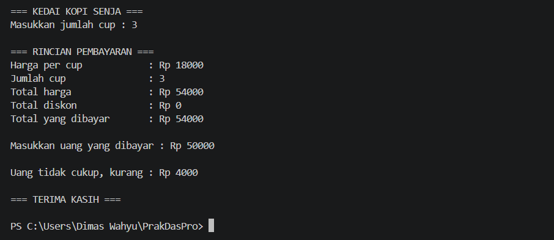
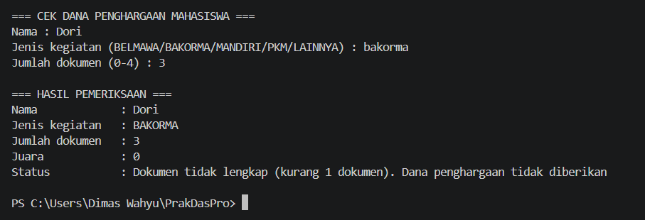

# Jobsheet 6 - Studi Kasus Pemilihan

**Identitas Mahasiswa:**
* **Nama:** Dimas Wahyu Ramadhani
* **NIM:** 264107020401
* **Kelas / No. Presensi: 1D / 12

___

## 1. TUJUAN PRAKTIKUM

Berikut adalah tujuan pelaksanaan praktikum pada bab ini:

1. Mahasiswa mampu menyelesaikan studi kasus menggunakan struktur pemilihan dasar dan pemilihan bersarang.
2. Mahasiswa mampu menyimpan dan mengumpulkan pekerjaan menggunakan Git dan GitHub melalui Visual Studio Code.
3. Mahasiswa mampu berkolaborasi dengan teman menggunakan GitHub.

--- 

## 2: HASIL PERCOBAAN DAN ANALISIS

### 2.1 Percobaan 1: Menyiapkan Repository
Pada percobaan ini dibuat repository PraktikumDaspro14 di GitHub, lalu di-clone ke komputer melalui Visual Studio Code. Setelah itu dibuat file README.md berisi identitas, kemudian disimpan dengan alur Add → Commit → Push.

Alur kerja Git yang digunakan:
* Clone: menduplikasi repository GitHub ke komputer.
* Add: memilih perubahan yang akan disimpan ke staging area.
* Commit: menyimpan perubahan sebagai version baru di local repository.
* Push: mengirim commit dari local repository ke GitHub.
---
### 2.2 Percobaan 2: Pemilihan Dasar
Kedai Kopi Senja menjual Kopi Susu Gula Aren seharga Rp18.000 per cup dan memberikan diskon 10% untuk pembelian minimal Rp100.000. Pemilik kedai membutuhkan program kasir sederhana untuk menghitung total bayar dan kembalian. Buatlah program Java berdasarkan flowchart berikut.

#### 2.2.1 Kode Program Java
```java
import java.util.Scanner;

public class StudiKasus1 {
    public static void main(String[] args) {
        Scanner sc = new Scanner(System.in);

        int hargaPerCup = 18_000;
        int jumlahCup;
        int uangBayar;
        int totalHarga;
        int diskon;
        int totalBayar;
        int kembalian;
        int kurang;

        System.out.println("\n=== KEDAI KOPI SENJA ===");
        System.out.print("Masukkan jumlah cup : ");
        jumlahCup = sc.nextInt();

        totalHarga = jumlahCup * hargaPerCup;
        diskon = 0;

        if (totalHarga >= 100_000) {
            diskon = totalHarga * 10/100;
        }

        totalBayar = totalHarga - diskon;

        System.out.println("\n=== RINCIAN PEMBAYARAN ===");
        System.out.println("Harga per cup\t\t : Rp " + hargaPerCup);
        System.out.println("Jumlah cup\t\t : " + jumlahCup);
        System.out.println("Total harga\t\t : Rp " + totalHarga);
        System.out.println("Total diskon\t\t : Rp " + diskon);
        System.out.println("Total yang dibayar\t : Rp " + totalBayar);

        System.out.print("\nMasukkan uang yang dibayar : Rp ");
        uangBayar = sc.nextInt();
        System.out.println();

        if (uangBayar >= totalBayar) {
            kembalian = uangBayar - totalBayar;
            System.out.println("Kembalian\t : Rp " + kembalian);
        } else {
            kurang = totalBayar - uangBayar;
            System.out.println("Uang tidak cukup, kurang : Rp " + kurang);
        }

        System.out.println("\n=== TERIMA KASIH ===\n");
        sc.close();
    }
}
```

#### 2.2.2 Hasil Running / Screenshot Output
Berikut adalah contoh tampilan *output* setelah program dijalankan: 


---

### 2.3 Percobaan 3: Pemilihan Bersarang
Bagian Kemahasiswaan Politeknik Negeri Malang menerbitkan surat mengenai validasi kelengkapan dokumen prestasi mahasiswa Tahun Kegiatan 2026 Tahap I. Berdasarkan ketentuan dalam surat tersebut, dana penghargaan dari institusi diberikan kepada mahasiswa dengan ketentuan sebagai berikut: 
* Untuk perlombaan yang diselenggarakan oleh BELMAWA, BAKORMA, atau Mandiri, dana penghargaan hanya diberikan kepada peraih Juara 1, 2, atau 3. Juara Harapan atau peserta tidak memperoleh dana penghargaan.
* Untuk Program Kreativitas Mahasiswa (PKM), dana penghargaan diberikan kepada tim yang lolos pendanaan. 
* Kegiatan di luar kedua ketentuan di atas (Lainnya) tidak memperoleh dana penghargaan. 
Selain itu, mahasiswa yang memenuhi ketentuan a atau b wajib mengupload 4 dokumen secara lengkap di SIAKAD, yaitu Surat Tugas, Sertifikat, Foto Kegiatan, dan Poster Kegiatan. Jika dokumen yang diupload kurang dari 4, data dianggap tidak lengkap dan dana penghargaan tidak diberikan. 

#### 2.3.1 Kode Program Java
```java
import java.util.Scanner;

public class StudiKasus2 {
    public static void main(String[] args) {
        Scanner sc = new Scanner(System.in);

        String nama;
        String jenisKegiatan;
        String status = " ";
        int jumlDokumen = 0;
        int juara = 0;

        System.out.println("\n=== CEK DANA PENGHARGAAN MAHASISWA ===");
        System.out.print("Nama : ");
        nama = sc.nextLine();
        System.out.print("Jenis kegiatan (BELMAWA/BAKORMA/MANDIRI/PKM/LAINNYA) : ");
        jenisKegiatan = sc.nextLine();

        if (jenisKegiatan.equalsIgnoreCase("BELMAWA") || jenisKegiatan.equalsIgnoreCase("BAKORMA")
                || jenisKegiatan.equalsIgnoreCase("MANDIRI")) {
            System.out.print("Jumlah dokumen (0-4) : ");
            jumlDokumen = sc.nextInt();
            if (jumlDokumen < 4) {
                int kurang = 4 - jumlDokumen;
                status = "Dokumen tidak lengkap (kurang " + kurang + " dokumen). Dana penghargaan tidak diberikan";
            } else {
                System.out.print("Peringkat juara (1, 2, 3 atau 0 jika bukan juara) : ");
                juara = sc.nextInt();
                if (juara >= 1 && juara <= 3) {
                    System.out.println("Peringkat juara : " + juara);
                    status = "Dana penghargaan diberikan";
                } else {
                    status = "Bukan juara 1, 2, atau 3. Dana penghargaan tidak diberikan";
                }
            }
        } else if (jenisKegiatan.equalsIgnoreCase("PKM")) {
            System.out.print("Jumlah dokumen (0-4) : ");
            jumlDokumen = sc.nextInt();
            if (jumlDokumen < 4) {
                int kurang = 4 - jumlDokumen;
                status = "Dokumen tidak lengkap (kurang " + kurang + " dokumen). Dana penghargaan tidak diberikan";
            } else {
                System.out.print("Status pendanaan (1 = lolos, 0 = tidak lolos) : ");
                int pendanaan = sc.nextInt();
                if (pendanaan == 1) {
                    status = "Dana penghargaan diberikan";
                } else {
                    status = "Dana penghargaan tidak diberikan";
                }
            }
        } else {
            status = "Kegiatan di luar ketentuan. Dana penghargaan tidak diberikan";
        }
        System.out.println("\n=== HASIL PEMERIKSAAN ===");
        System.out.println("Nama\t\t : " + nama);
        System.out.println("Jenis kegiatan \t : " + jenisKegiatan.toUpperCase());
        System.out.println("Jumlah dokumen\t : " + jumlDokumen);
        System.out.println("Juara\t\t : " + juara);
        System.out.println("Status\t\t : " + status);
        System.out.println();
        sc.close();
    }
}
```

#### 2.3.2 Hasil Running / Screenshot Output
Berikut adalah contoh tampilan *output* setelah program dijalankan:


---

### 2.4 Percobaan 4: Uji Silang Program Teman
Pada percobaan ini repository dibagikan kepada teman melalui Settings → Collaborators → Add people. Teman yang diundang meng-clone repository, menjalankan StudiKasus214.java dengan minimal 3 data uji, lalu menuliskan hasilnya di bagian bawah README.md dan melakukan Commit & Push. Pemilik repository kemudian melakukan Pull untuk mengambil perubahan tersebut dan memeriksa riwayat commit.

---

## 3. KESIMPULAN
* Pemilihan dasar `If` pada Studi Kasus 1 digunakan untuk menentukan diskon dan menentukan apakah uang bayar cukup atau kurang.
* Pemilihan bersarang `Nested If` pada Studi Kasus 2 digunakan untuk memeriksa syarat secara bertingkat, mulai dari jenis kegiatan, syarat juara atau pendanaan PKM, hingga kelengkapan dokumen, sehingga setiap kegagalan dapat menampilkan alasan yang berbeda.
* Git dan GitHub memungkinkan pekerjaan disimpan secara bertahap melalui Add, Commit, dan Push, sehingga setiap tahap pengerjaan tercatat dalam riwayat commit.
* Kolaborasi di GitHub melalui fitur Collaborators memungkinkan teman meng-clone, menguji program, dan mengirim hasil uji ke repository yang sama, lalu pemilik repository mengambilnya dengan Pull. Pull sebaiknya dilakukan sebelum mengubah file yang sama untuk mencegah konflik.