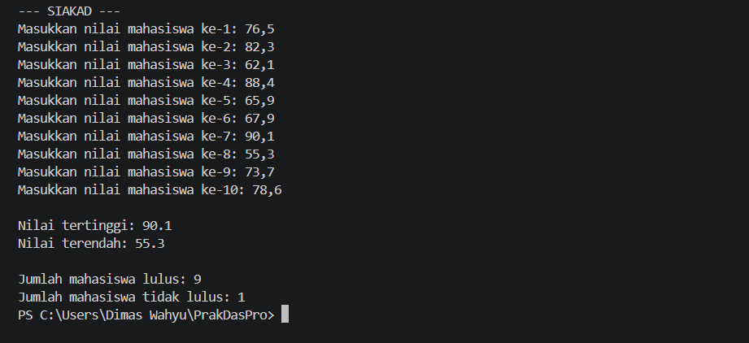
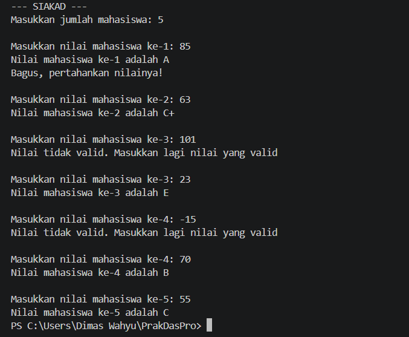
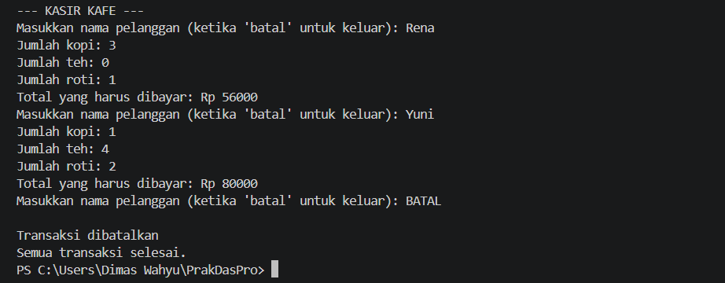
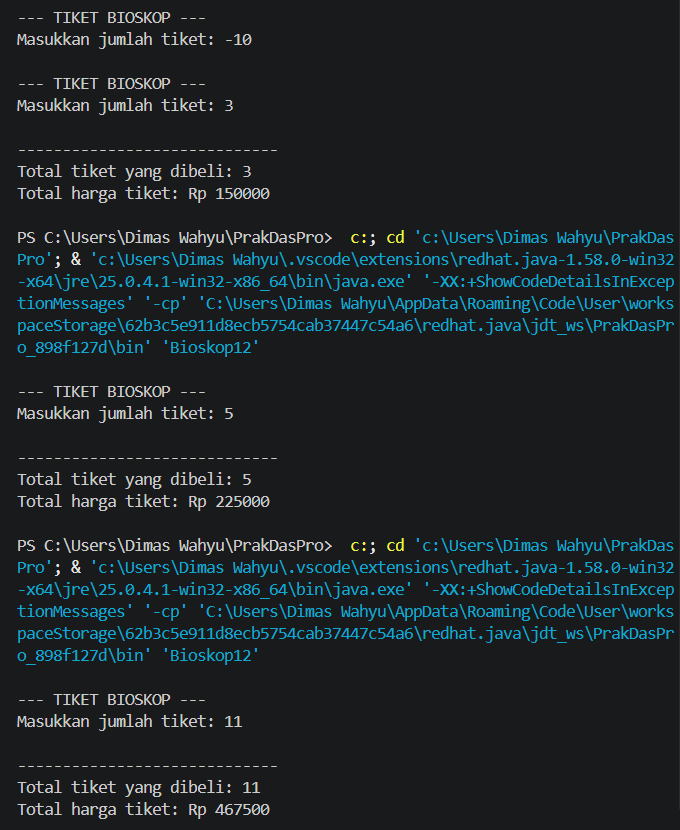
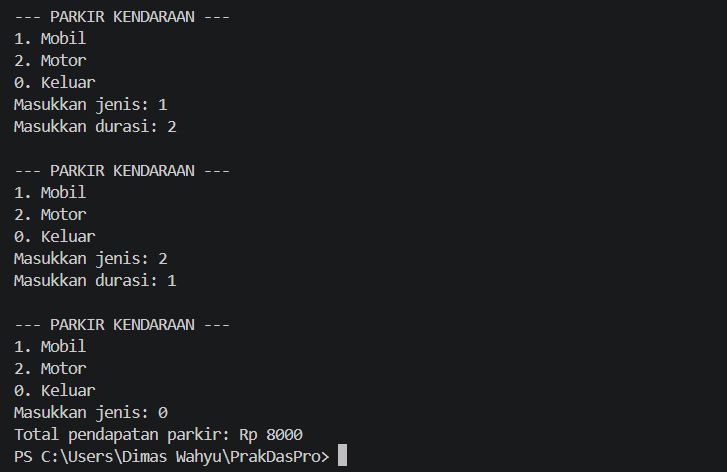

# JOBSHEET 7 - PERULANGAN 1

**Identitas Mahasiswa:**
* **Nama:** Dimas Wahyu Ramadhani
* **NIM:** 264107020104
* **Kelas / No. Presensi:** 1D / 12

___

## 1. TUJUAN PRAKTIKUM

Berikut adalah tujuan pelaksanaan praktikum pada bab ini:

1. Mahasiswa dapat menjelaskan format penulisan program perulangan (for, while, dan do-while) 
2. Mahasiswa dapat mengimplementasikan flowchart perulangan menggunakan bahasa pemrograman Java 

- - -

## 2. HASIL PERCOBAAN & ANALISIS

### 2.1 Percobaan 1: Perulangan For
Di dalam Sistem Informasi Akademik (SIAKAD), dosen mengisi nilai mata kuliah Praktikum Dasar Pemrograman yang ditempuh oleh mahasiswa. Dosen tersebut ingin mencari nilai tertinggi dan terendah Kuis dari 10 mahasiswa di dalam satu kelas. Dosen tersebut harus memasukkan nilai dari setiap siswa, kemudian menentukan dan menampilkan nilai tertinggi dan terendah. 

#### 2.1.1 Kode Program Java
```java
import java.util.Scanner;

public class SiakadFor12 {
    public static void main(String[] args) {
        Scanner sc = new Scanner (System.in);

        double nilai, tertinggi = 0, terendah = 100;

        for (int i = 1; i <= 10; i++) {
            System.out.print("Masukkan nilai mahasiswa ke-" + i + ": ");
            nilai = sc.nextDouble();
            if (nilai > tertinggi) {
                tertinggi = nilai;
            }
            if (nilai < terendah) {
                terendah = nilai;
            }
        }
        System.out.println("Nilai tertinggi: " + tertinggi);
        System.out.println("Nilai terendah: " + terendah);
        sc.close();
    }
}
```
#### 2.1.2 Hasil Running / Screenshot Output
Berikut adalah contoh tampilan *output* setelah program dijalankan:

#### 2.1.3 Jawaban Pertanyaan / Pertanyaan Refleksi
* **Pertanyaan 1:** Sebutkan dan tunjukkan masing-masing komponen perulangan FOR pada kode program percobaan 1!
    * **Jawab:** 
        * Inisialisasi: `int i = 1` menginisialisasi variabel `i` bernilai 1.
        * Kondisi:  `i <= 10` melakukukan perulangan selama `i` kurang dari sama dengan 10.
        * Update: `i++` menambahkan nilai `i` sebesar 1 pada setiap perulangan.
* **Pertanyaan 2:** Mengapa variabel tertinggi diinisialisasi 0 dan terendah diinisialisasi 100? Apa yang terjadi jika variabel tertinggi diinisialisasi 100 dan terendah diinisialisasi 0?
    * **Jawab:** Variabel `tertinggi` diinisialisasi dengan 0 karena nilai tersebut merupakan nilai awal terendah, sedangkan terendah diinisialisasi dengan 100 karena merupakan nilai awal `tertinggi` dalam rentang nilai 0–100. Jika `tertinggi` diinisialisasi 100 dan terendah diinisialisasi 0, hasilnya bisa salah karena nilai mahasiswa umumnya tidak lebih dari 100 untuk memperbarui `tertinggi` dan tidak kurang dari 0 untuk memperbarui terendah. 
* **Pertanyaann 3:** Jelaskan fungsi dan alur kerja dari potongan kode berikut!
    ```java
    if (nilai > tertinggi) {
    tertinggi = nilai;
    }
    if (nilai < terendah) {
    terendah = nilai;
    }
    ```
    * **Jawab:** 
        * Kondisi `if (nilai > tertinggi)` digunakan untuk memeriksa apakah nilai yang dimasukkan lebih besar daripada nilai tertinggi sebelumnya. Jika benar, variabel tertinggi diperbarui dengan nilai tersebut.
        * Kondisi `if (nilai < terendah)` digunakan untuk memeriksa apakah nilai yang dimasukkan lebih kecil daripada nilai terendah sebelumnya. Jika benar, variabel terendah diperbarui dengan nilai tersebut.
* **Pertanyaan 4:** Modifikasi kode program sehingga terdapat perhitungan untuk menentukan berapa mahasiswa yang lulus dan tidak lulus berdasarkan batas kelulusan (nilai minimal 60). Tampilkan jumlah mahasiswa lulus dan tidak lulus setelah menampilkan nilai tertinggi dan terendah!
    * **Jawab:** 
        ```java
        import java.util.Scanner;

        public class SiakadFor12 {
            public static void main(String[] args) {
            Scanner sc = new Scanner(System.in);

            int lulus = 0, tidakLulus = 0;
            double nilai, tertinggi = 0, terendah = 100;

            System.out.println("--- SIAKAD ---");
            for (int i = 1; i <= 10; i++) {
                System.out.print("Masukkan nilai mahasiswa ke-" + i + ": ");
                nilai = sc.nextDouble();
                if (nilai > tertinggi) {
                   tertinggi = nilai;
                }
                if (nilai < terendah) {
                    terendah = nilai;
                }
                if (nilai >= 60) {
                    lulus++;
                } else {
                    tidakLulus++;
                }
            }

            System.out.println("\nNilai tertinggi: " + tertinggi);
            System.out.println("Nilai terendah: " + terendah);
            System.out.println("\nJumlah mahasiswa lulus: " + lulus);
            System.out.println("Jumlah mahasiswa tidak lulus: " + tidakLulus);
            sc.close();
            }
        }
        ```
---

### 2.2 Percobaan 2: Perulangan While
Seorang dosen ingin memasukkan nilai beberapa mahasiswa ke dalam SIAKAD untuk ditentukan kategori nilai hurufnya. Program harus meminta dosen untuk memasukkan nilai setiap mahasiswa. Jika dosen memasukkan nilai yang tidak valid (negatif atau lebih dari 100), program harus mengabaikan input tersebut dan meminta dosen untuk melakukan input ulang. Selanjutnya, nilai yang valid dikelompokkan ke dalam kategori huruf A (80 < nilai ≤ 100), B+ (73 < nilai ≤ 80), B (65 < nilai ≤ 73), C+ (60 < nilai ≤ 65), C (50 < nilai ≤ 60), D (39 < nilai ≤ 50), dan E (nilai ≤ 39). 
#### 2.2.1 Kode Program Java
```java
import java.util.Scanner;

public class SiakadWhile12 {
    public static void main(String[] args) {
        Scanner sc = new Scanner(System.in);

        int nilai, jml,i = 0;

        System.out.println("--- SIAKAD ---");
        System.out.print("Masukkan jumlah mahasiswa: ");
        jml = sc.nextInt();

        while (i < jml) {
            System.out.print("Masukkan nilai mahasiswa ke-" + (i + 1) + ": ");
            nilai = sc.nextInt();

            if (nilai < 0 || nilai > 100) {
                System.out.println("Nilai tidak valid. Masukkan lagi nilai yang valid");
                continue;
            }
            if (nilai > 80 && nilai <= 100) {
                System.out.println("Nilai mahasiswa ke-" + (i+1) + " adalah A");
            } else if (nilai > 73 && nilai <= 80) {
                System.out.println("Nilai mahasiswa ke-" + (i+1) + " adalah B+");
            } else if (nilai > 65 && nilai <= 73) {
                System.out.println("Nilai mahasiswa ke-" + (i+1) + " adalah B");
            } else if (nilai > 60 && nilai <= 65) {
                System.out.println("Nilai mahasiswa ke-" + (i+1) + " adalah C+");
            } else if (nilai > 50 && nilai <= 60) {
                System.out.println("Nilai mahasiswa ke-" + (i+1) + " adalah C");
            } else if (nilai > 39 && nilai <= 50) {
                System.out.println("Nilai mahasiswa ke-" + (i+1) + " adalah D");
            } else {
                System.out.println("Nilai mahasiswa ke-" + (i+1) + " adalah E");
            }
            i++;
        }
        sc.close();
    }   
}
```
#### 2.2.2 Hasil Running / Screenshot Output
Berikut adalah contoh tampilan *output* setelah program dijalankan:


#### 2.2.3 Jawaban Pertanyaan / Pertanyaan Refleksi
* **Pertanyaan 1:** Pada potongan kode berikut, tentukan maksud dan kegunaaan dari sintaks berikut:
    ```java
    if (nilai < 0 || nilai > 100) {
        System.out.println("Nilai tidak valid. Masukkan lagi nilai yang valid1");
        continue;
    }
    ```
    a. `nilai <0 || nilai > 100`  
    b. `continue`
    * **Jawab:**
        * `nilai < 0 || nilai > 100` digunakan untuk mengecek nilai apakah nilai tersebut berada di rentang 0-100. Jika nilai kurang dari 0 atau lebih dari 100, maka akan melakukan input ulang.
        * `continue` digunakan untuk melakukan perulangan dengan melewati perintah yang ada di bawahnya.
* **Pertanyaan 2:** Mengapa sintaks `i++` dituliskan di akhir perulangan WHILE? Apa yang terjadi jika posisinya dituliskan di awal perulangan WHILE?
    * **Jawab:** Agar variabel `i` bertambah setelah memasukkan nilai mahasiswa. Jika `i++` diletakkan di awal, nilai `i` akan bertambah meskipun input yang dimasukkan tidak valid dan `continue` dijalankan.
* **Pertanyaan 3:** Apabila jumlah mahasiswa yang dimasukkan adalah 19, berapa kali perulangan WHILE akan berjalan?
    * **Jawab:** Akan mengulang sebanyak 19 kali jika semua nilai yang dimasukkan valid.
* **Pertanyaan 4:** Modifikasi kode program sehingga apabila terdapat mahasiswa yang mendapat nilai A, program akan menampilkan pesan tambahan "Bagus, pertahankan nilainya!"!
    * **Jawab:**
        ```java
        import java.util.Scanner;

        public class SiakadWhile12 {
            public static void main(String[] args) {
                Scanner sc = new Scanner(System.in);

                int nilai, jml,i = 0;

                System.out.println("--- SIAKAD ---");
                System.out.print("Masukkan jumlah mahasiswa: ");
                jml = sc.nextInt();

                while (i < jml) {
                    System.out.print("\nMasukkan nilai mahasiswa ke-" + (i + 1) + ": ");
                    nilai = sc.nextInt();

                    if (nilai < 0 || nilai > 100) {
                        System.out.println("Nilai tidak valid. Masukkan lagi nilai yang valid");
                        continue;
                    }
                    if (nilai > 80 && nilai <= 100) {
                        System.out.println("Nilai mahasiswa ke-" + (i+1) + " adalah A");
                        System.out.println("Bagus, pertahankan nilainya!");
                    } else if (nilai > 73 && nilai <= 80) {
                        System.out.println("Nilai mahasiswa ke-" + (i+1) + " adalah B+");
                    } else if (nilai > 65 && nilai <= 73) {
                        System.out.println("Nilai mahasiswa ke-" + (i+1) + " adalah B");
                    } else if (nilai > 60 && nilai <= 65) {
                        System.out.println("Nilai mahasiswa ke-" + (i+1) + " adalah C+");
                    } else if (nilai > 50 && nilai <= 60) {
                        System.out.println("Nilai mahasiswa ke-" + (i+1) + " adalah C");
                    } else if (nilai > 39 && nilai <= 50) {
                        System.out.println("Nilai mahasiswa ke-" + (i+1) + " adalah D");
                    } else {
                        System.out.println("Nilai mahasiswa ke-" + (i+1) + " adalah E");
                    }
                    i++;
                }
                sc.close();
            }   
        }
        ```
---

### 2.3 Percobaan 3: Perulangan D0-While
Di sebuah kafe, kasir ingin memproses transaksi beberapa pelanggan. Pelanggan dapat membeli lebih dari satu item (kopi dengan harga Rp 12.000, teh dengan harga Rp 7.000, dan roti dengan harga Rp 20.000), dan kasir akan terus memasukkan jumlah pembelian untuk setiap pelanggan. Jika ada pelanggan yang memutuskan untuk membatalkan transaksi (dengan memasukkan "batal"), maka kasir akan menghentikan input transaksi dan program berhenti. 

#### 2.3.1 Kode Program Java
```java
import java.util.Scanner;

public class KafeDoWhile12 {
    public static void main(String[] args) {
        Scanner sc = new Scanner(System.in);

        int kopi, teh, roti;
        String namaPelanggan;
        int hargaKopi = 12000, hargaTeh = 7000, hargaRoti = 20000;

        do {
            System.out.print("Masukkan nama pelanggan (ketika 'batal' untuk keluar): ");
            namaPelanggan = sc.nextLine();
            if (namaPelanggan.equalsIgnoreCase("batal")) {
                System.out.println("Transaksi dibatalkan");
                break;
            }
            System.out.print("Jumlah kopi: ");
            kopi = sc.nextInt();
            System.out.print("Jumlah teh: ");
            teh = sc.nextInt();
            System.out.print("Jumlah roti: ");
            roti = sc.nextInt();
            int totalHarga = (kopi * hargaKopi) + (teh * hargaTeh) + (roti * hargaRoti);
            System.out.println("Total yang harus dibayar: Rp " + totalHarga);
            sc.nextLine();
        } while (true);
        System.out.println("Semua transaksi selesai.");
        sc.close();
    }
}
```
#### 2.3.2 Hasil Running / Screenshot Output
Berikut adalah contoh tampilan *output* setelah program dijalankan:


#### 2.3.3 Jawaban Pertanyaan / Pertanyaan Refleksi
* **Pertanyaan 1:** Pada penggunaan DO-WHILE ini, apabila nama pelanggan yang dimasukkan pertama kali adalah "batal", maka berapa kali perulangan dilakukan?
    * **Jawab:** Dilakukan 1 kali karena `Do-While` menjalankan kode terlebih dahulu kemudian mengecek kondisi. Program langsung berhenti karena terdapat `break`.
* **Pertanyaan 2:** Sebutkan kondisi berhenti yang digunakan pada perulangan DO-WHILE tersebut!
    * **Jawab:** `break` untuk menghentikan perulangan.
* **Pertanyaan 3:** Apa fungsi dari penggunaan nilai true pada kondisi DO-WHILE?
    * **Jawab:** Nilai `true` berfungsi untuk melakukan pengulangan terus berjalan jika tidak ada perintah untuk menghentikannya.
* **Pertanyaan 4:** Mengapa perulangan DO-WHILE tersebut tetap berjalan meskipun tidak ada komponen inisialisai dan update?
    * **Jawab:** Karena `Do-While` tidak mewajibkan adanya inisialisasi dan update. Pengulangan akan terus berjalan ketika kondisi `while (true)` dan dapat dihentikan dengan `break` ketika memasukkan `"batal"`.
---

## 3. TUGAS
Berikut adalah daftar tugas yang dikerjakan pada Jobsheet ini:
- [x] **Tugas 1:** Membuat program menggunakan `Do-While`.
- [x] **Tugas 2:** Membuat program menggunakan Nested IF.

### 3.1 Tugas 1
#### 3.1.1 Kode Program Java
```java
import java.util.Scanner;

public class Bioskop12 {
    public static void main(String[] args) {
        Scanner sc = new Scanner(System.in);

        int hargaTiket = 50000;
        int jmlTiket;
        double diskon = 0;

        do {
            System.out.println("\n--- TIKET BIOSKOP ---");
            System.out.print("Masukkan jumlah tiket: ");
            jmlTiket = sc.nextInt();
        } while (jmlTiket < 0);

        if (jmlTiket > 10) {
            diskon = 0.15;
        } else if (jmlTiket > 4) {
            diskon = 0.10;
        } else {
            diskon = 0;
        }

        int totHarga = (int) ((hargaTiket * jmlTiket) - ((hargaTiket * jmlTiket) * diskon));

        System.out.println("\n-----------------------------");
        System.out.println("Total tiket yang dibeli: " + jmlTiket);
        System.out.println("Total harga tiket: Rp " + totHarga);
        System.out.println();
        sc.close();
    }
}
```
#### 3.1.2 Hasil Running / Screenshoot Output
Berikut adalah contoh tampilan *output* setelah program dijalankan:


---
### 3.2 Tugas 2
#### 3.2.1 Kode Program Java
```java
import java.util.Scanner;

public class Parkir12 {
    public static void main(String[] args) {
        Scanner sc = new Scanner(System.in);

        int jenis, durasi, total = 0;

        do {
            System.out.println("\n--- PARKIR KENDARAAN ---");
            System.out.println("1. Mobil");
            System.out.println("2. Motor");
            System.out.println("0. Keluar");
            System.out.print("Masukkan jenis: ");
            jenis = sc.nextInt();
            if (jenis == 1 || jenis == 2) {
                System.out.print("Masukkan durasi: ");
                durasi = sc.nextInt();
                if (jenis == 1) {
                    total += durasi * 3000;
                } else {
                    total += durasi * 2000;
                }
            }
        } while (jenis != 0);

        System.out.println("Total pendapatan parkir: Rp " + total);
        sc.close();
    }
}
```

#### 3.2.2 Hasil Running / Screenshoot Output
Berikut adalah contoh tampilan *output* setelah program dijalankan:


---

## 4. KESIMPULAN